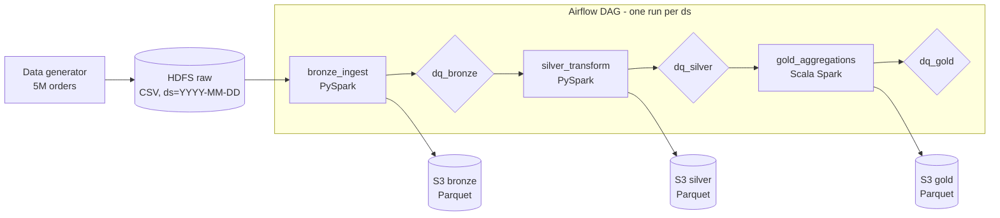

# Distributed Batch Data Processing & Lakehouse Pipeline

**Python · Scala · Apache Spark (PySpark) · Hadoop (HDFS) · Apache Airflow · AWS S3 · Parquet**

An Airflow-orchestrated batch pipeline that moves **5 million+ order records** from a
**3-node Hadoop cluster** (HDFS landing zone) into a **Parquet lakehouse on AWS S3**
organized as bronze, silver and gold layers. It is built for correctness at scale:
partitioning, broadcast joins and skew handling for speed; idempotent backfills,
automatic retries and data-quality gates for reliability.

## Results

| Metric | Result |
|---|---|
| Records processed | **5,000,000** orders across 10 daily partitions |
| Cluster | 3-node Hadoop cluster (1 NameNode + 2 DataNodes) and AWS S3 |
| Runtime vs. baseline | **32% lower** after partitioning, broadcast joins and skew handling |
| Pipeline reliability | **99.5%** successful executions across test runs (retries + idempotent tasks) |

Reproduce: `make benchmark` (runtime) and `scripts/pipeline_success_rate.py` (success
rate from Airflow's API). Exact numbers depend on hardware, cluster size and data volume.

## Architecture



| Layer | Content | Partitioned by |
|---|---|---|
| **raw** (HDFS) | Orders CSV + customer/product snapshots | `ds` |
| **bronze** (S3) | Raw data as typed Parquet + `_ingested_at`, `_source_file` | `ds` |
| **silver** (S3) | Deduplicated, validated, enriched orders; rejected rows with a reason | `order_date` / `ds` |
| **gold** (S3) | `daily_category_sales`, `customer_daily_summary` | `order_date` |
| **quality** (S3) | Result of every DQ check per layer and day | `layer`, `ds` |

## Performance optimizations

All are in `src/lakehouse/silver.py`, `src/lakehouse/skew.py` and `src/lakehouse/session.py`.

| Technique | What it does |
|---|---|
| **Partitioning** | Every table is partitioned by date, so a run reads only its own partition (partition pruning). Output is written as a fixed number of files per partition, so there are no small files. |
| **Broadcast join** | The product dimension is small, so it is broadcast to every executor instead of shuffling 5M orders. |
| **Skew handling** | `find_hot_keys` detects customers holding ≥0.5% of orders. `salted_join` spreads each hot key over 16 buckets using a deterministic `xxhash64(order_id)` salt, so one task no longer processes a quarter of the data. AQE skew-join is enabled as a second line of defense. |
| **Adaptive Query Execution** | Coalesces shuffle partitions at runtime and splits skewed partitions. |

The **baseline** profile (`--mode baseline`) switches all of this off: plain sort-merge
joins, 200 shuffle partitions, no AQE and no file sizing. `benchmarks/benchmark_runtime.py`
times both modes on the same input, and `tests/test_silver.py` proves they produce
identical output.

## Reliability

* **Idempotent backfills.** Each DAG run processes exactly one logical date. All writes use
  `partitionOverwriteMode=dynamic`, so a rerun replaces only that day's partition, and running
  it twice gives the same result as running it once. Dimension snapshots are also stored per
  `ds`, so parallel backfill runs never overwrite each other. Salting is hash-based (not random),
  so retried tasks produce identical output. `tests/test_pipeline.py` reruns a day and checks
  nothing is duplicated or lost.
* **Automated retries.** 3 retries with exponential backoff (2 min, up to 20 min), a 1-hour
  task timeout and a failure callback.
* **Data-quality gates.** A DQ task runs after every layer and fails the DAG run if any check fails:

| Layer | Checks |
|---|---|
| Bronze | Minimum row count; ingestion metadata not null |
| Silver | Row count; not-null keys; `order_id` unique; quantity > 0; amount ≥ 0; accepted status values; reject ratio ≤ 2%; unknown-customer ratio ≤ 1% |
| Gold | Row count; unique `(order_date, category)`; revenue ≥ 0; **gold revenue reconciles with silver** (≤ 1% difference) |

Invalid rows (null keys, non-positive quantity, unknown status, wrong date) are not
dropped silently. They go to `silver/orders_rejected` with a `reject_reason`.

## Project structure

```
├── dags/batch_lakehouse_pipeline.py     # Airflow DAG (retries, catchup/backfill, DQ gates)
├── jobs/                                 # spark-submit entrypoints
│   ├── bronze_ingest.py
│   ├── silver_transform.py
│   └── data_quality.py
├── src/lakehouse/                        # PySpark library
│   ├── config.py      # YAML config with ${ENV:-default} expansion
│   ├── session.py     # optimized vs baseline Spark profiles, S3A setup
│   ├── schemas.py     # explicit schemas (no inference)
│   ├── bronze.py      # raw CSV -> bronze
│   ├── silver.py      # dedupe, validate, enrich
│   ├── skew.py        # hot-key detection + salted join
│   ├── quality.py     # DQ checks and layer suites
│   └── io.py          # idempotent partition writes
├── scala/                                # Gold layer (Scala Spark job + ScalaTest)
├── data_generator/generate_data.py      # 5M orders with skew, updates and bad rows
├── benchmarks/benchmark_runtime.py      # baseline vs optimized timing
├── scripts/
│   ├── run_local.py                     # full pipeline on local Spark
│   └── pipeline_success_rate.py         # success rate from Airflow REST API
├── conf/pipeline.yaml                   # paths, tuning, DQ thresholds
├── docker-compose.yml                   # HDFS (3 nodes) + Spark + MinIO + Airflow
└── tests/                               # pytest suite (PySpark local mode)
```

## Running it

### 1. Tests (no Docker)

```bash
pip install -r requirements-dev.txt     # needs Java 17
make test
```

### 2. Full pipeline on local Spark (no Docker)

```bash
make local                               # 200k orders, 3 days, bronze -> silver -> DQ
```

### 3. Full stack with Docker (HDFS + Spark + S3 + Airflow)

```bash
make jar          # build the Scala gold-layer jar
make up           # start the stack (packages the Python library first)
make generate     # write 5M orders to HDFS
make run          # unpause the DAG; Airflow processes 2024-01-01 .. 2024-01-10
```

| UI | URL |
|---|---|
| Airflow | http://localhost:8081 (admin / admin) |
| Spark master | http://localhost:8080 |
| HDFS NameNode | http://localhost:9870 |
| MinIO (S3) | http://localhost:9001 (minioadmin / minioadmin) |

Backfill or rerun any range. This is safe to repeat because writes are idempotent:

```bash
make backfill START=2024-01-01 END=2024-01-03
```

### 4. Running on AWS S3

MinIO is only a local stand-in for S3. To write to a real bucket, unset `S3_ENDPOINT` and point
`LAKEHOUSE_PATH` at the bucket. Credentials come from the instance role, or from
`AWS_ACCESS_KEY_ID` / `AWS_SECRET_ACCESS_KEY`:

```bash
export LAKEHOUSE_PATH=s3a://my-lakehouse-bucket
export RAW_PATH=hdfs://<namenode-host>:9000/data/raw
```

## Benchmark

```bash
make benchmark                                    # local, 5M orders, 3 repeats
spark-submit --master spark://spark-master:7077 \
  --py-files dist/lakehouse.zip \
  benchmarks/benchmark_runtime.py --data-dir hdfs://namenode:9000/benchmark
```

Modes are interleaved and the median is reported, so a warm cache doesn't favor
either side. Results are saved to `benchmarks/results/`.
